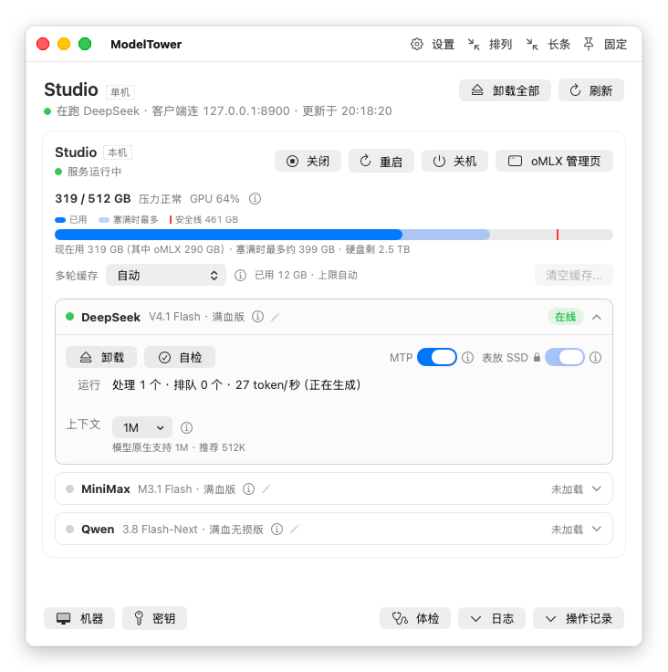
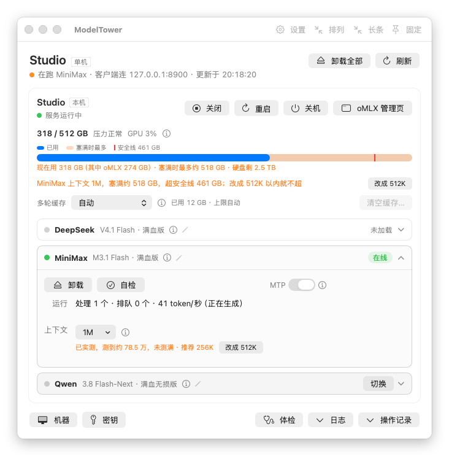
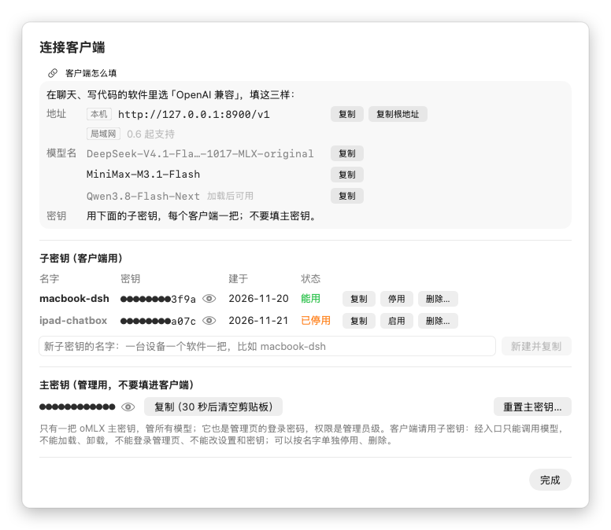

# ModelTower

**Run open-source LLMs on your own Mac, all from one window.**

Install the engine, pick a model, load it with one click, let it test itself, and hand out keys to your apps. No commands to type. The models run on this Mac, so your conversations stay on it.

  

[简体中文](README.zh-CN.md) · [Guide](docs/guide.en.md) · [FAQ](docs/faq.en.md) · [Changelog](CHANGELOG.md)

The main window (the numbers are sample data). Measured on a 512 GB Mac Studio (M3 Ultra): DeepSeek V4.1 Flash at full precision, about 330 GB, loaded in 53 seconds and passed its self-test.

## Core features

### 🧭 One-click loading, with the math done first

- **Finds the models you already have**: models on this Mac are listed automatically. Models in another folder? Pick the folder and they are added.
- **Load, unload, switch**: one click on the model card. If two models will not fit together, the button says **Switch**: it unloads the other one first, then loads this one.
- **Know before you load**: how much memory it needs, roughly how long it takes, and whether this Mac has room.
- **Memory at a glance**: the memory bar shows what is in use now, the most it can reach when conversations fill the context, and where the safety line is. Before you cross it, a warning says why and how to fix it, with a one-click button to lower the context.

### ⚡ Faster, and fits in less memory

Set per model. Each switch appears only when oMLX reports that the model supports it, and the ⓘ next to it explains the benefit, the cost and when to turn it on.

- **MTP (multi-token prediction)**: the model drafts several tokens ahead and verifies them together, keeping the ones that match. The output is identical. The speed-up is biggest when it writes a lot: code, reasoning, long answers.
- **Tables on SSD**: keeps the model's lookup tables on the SSD and reads them on demand. The output is identical and it frees up a large chunk of memory. Turn it on when memory is tight or another large program needs to run alongside.
- **Context**: pick a size. If a full context would cross the safety line, you are told in advance and shown which size stays under it.
- **Multi-turn cache**: saves earlier turns of a conversation to disk so the next turn does not start from scratch. Choose Auto, set a limit, or turn it off.

### ✅ Peace of mind

- **Self-test**: once a model is loaded, it answers a test question; it only counts as ready when the answer is right. If something is wrong, you see it right away, not when your app throws an error.
- **Health Check**: checks the service, ports and permissions one by one, and says why anything fails.
- **Activity and logs**: every step, what it did and how long it took.

### 🔑 Works with the apps you already use

- **Connect Clients page**: the address, model names and keys on one page, each with a copy button. In your chat or coding app, choose "OpenAI compatible" and you are done; web-based and Electron clients can connect too.
- **One sub-key per app**: disable, enable or delete each one on its own.
- **The Gateway keeps watch**: only models that are already loaded get through, so no app can quietly load another model and fill up your memory.

### 🌏 Installs oMLX smoothly wherever you are

- **A download source for your network**: GitHub's official releases worldwide, the ModelScope mirror in mainland China. On Auto, it tests both and downloads from the faster one.
- **Already have the installer?** Just pick it; no need to download again.
- **Verified after download**: wherever it comes from, the installer is checked against the SHA-256 in the compatibility table, and a single wrong byte means it is not installed. When oMLX releases a new version, the console verifies it before suggesting the upgrade.

## A closer look

**Would a full context cross the safety line? You see why, and Change to 512K fixes it**

**Connect Clients: the address, model names and sub-keys on one page, one key per app**

Screenshots show the Chinese interface; the app also comes in English.

## Get started in three steps

> [!IMPORTANT]
> **macOS blocks ModelTower the first time you open it. This is expected and does not mean anything is wrong with the app.** ModelTower is an independent open-source project and is not notarized by Apple (notarization requires a paid Apple Developer membership), so macOS says it cannot verify the app. Approve it once:
>
> 1. In the dialog, click **Done**. **Do not click Move to Trash.**
> 2. Open **System Settings → Privacy & Security**, scroll to **Security**, click **Open Anyway** next to ModelTower, and confirm with your Mac password or Touch ID.
> 3. From then on it opens normally.
>
> **Open Anyway** only shows up for about an hour after the app was blocked; if it is not there, double-click ModelTower again. Already clicked Move to Trash? Put it back from the Trash. Want to check the download first? The source code is in this repository, and the `.sha256` file next to the zip verifies the download. More in the [FAQ](docs/faq.en.md#macos-says-it-cannot-verify-modeltower-or-offers-to-move-it-to-the-trash).

1. **Download**: get the latest zip from [Releases](https://github.com/dan-cube/modeltower/releases), unzip it, and drag ModelTower into Applications. The `.sha256` file next to it lets you check the download.
2. **Open it the first time**: approve it once as described above.
3. **Follow Get Started**: install oMLX (from GitHub, the ModelScope mirror, or an installer you already have) → find your existing models (or download one in oMLX) → pick one and click **Load and self-test**.

Then, in your chat or coding app, choose "OpenAI compatible" and enter the three things from the **Connect Clients** page:

| Field | What to enter |
|---|---|
| Address | `http://127.0.0.1:8900/v1` (click **Copy** on the page) |
| Model name | One of the loaded models listed on the page |
| Key | A new sub-key made for this app |

The [guide](docs/guide.en.md) covers every step in detail.

## Requirements

- A Mac with Apple Silicon (M1 or later) and macOS 15 or later. These are [oMLX](https://github.com/jundot/omlx)'s requirements; its own documentation is the final word.
- Enough memory for the models you want to run. The app marks which models fit on this Mac.
- No oMLX yet? The app walks you through installing it the first time you open it.

## Roadmap

| Version | What it brings | Status |
|---|---|---|
| **0.5** | **Single Mac**: one Mac runs the models for the apps on that Mac | ✅ Available |
| **0.6** | **Local network**: computers and phones at home or in the office use this Mac's models, one key per device **Away from home**: connect back securely through mesh VPN apps such as Tailscale, PgyVPN or EasyTier | 🔜 Next |
| **1.0** | **Linked Macs**: manage the Macs at home together in one window, with a different model on each, and start or stop them all with one click. Pairing checks a fingerprint without handling the other Mac's password; revoke access at any time and choose how much access to give | 🗺️ Planned |
| **Manager edition** | Manage your model Macs remotely from a Mac that does not run models, such as a MacBook: see their status, load and switch models, hand out keys | 💡 Planned |

The roadmap may change based on feedback.

## Runs locally, so your data stays private

The models run on your own Mac; your conversations and files never pass through a cloud service. ModelTower collects no data, sends no reports and needs no account. It goes online only to download oMLX and to check for updates once a day, and it only reads, never uploads.

<b>Network details</b>

- **Downloading the oMLX installer**, from GitHub or ModelScope. With the download source set to Auto, it first briefly connects to both to compare speed.
- **Checking for updates**, on by default, once a day. It reads a small signed file with the oMLX compatibility table, the latest ModelTower version and notices. The file is kept in two places, this repository (GitHub) and the ModelScope mirror; if one cannot be reached it tries the other, and if neither can, nothing stops working. It rejects the file if the signature does not match. It only reads and uploads nothing. You can turn it off in **Settings → Updates**.
- Everything else stays on this Mac: the console, oMLX and the Gateway talk only over `127.0.0.1`. When it does go online, it follows the system proxy settings.
- **Main key**: the console remembers only whether you allowed it to read oMLX's main key. It never stores the key and reads it fresh each time.
- oMLX's own network use (downloading models, its built-in auto-update) is up to oMLX.

## Good to know

- It works with official oMLX only, installed from the official installer or with Homebrew.
- Models are not shipped with this app. You download them in oMLX from Hugging Face or ModelScope. Each model has its own license, so check it before use.
- The interface comes in English and Simplified Chinese and follows your system language.

## Dependencies and thanks

- **[oMLX](https://github.com/jundot/omlx)** (Apache-2.0) is the engine that actually runs the models. ModelTower does not bundle it; it works with oMLX's official installers. Thanks to oMLX's author and contributors.
- **[Apple MLX](https://github.com/ml-explore/mlx)** (MIT) is what oMLX uses to run models on Apple Silicon.
- **[The ModelScope mirror](https://www.modelscope.cn/models/skyeyes1999/omlx-release-copy)** is an unmodified copy of oMLX's official installers on ModelScope, with oMLX's LICENSE and a `SHA256SUMS` file. It is **not official** and is not affiliated with the oMLX project.

## Feedback

Please report problems and ideas in this repository's [Issues](https://github.com/dan-cube/modeltower/issues). For problems with oMLX itself, use [oMLX's repository](https://github.com/jundot/omlx). Remove any keys before pasting logs.

## License

ModelTower is released under the [Apache License 2.0](LICENSE). © 2026 dan-cube; see [NOTICE](NOTICE).

oMLX, Apple MLX and the models are not distributed with this repository and are covered by their own licenses (oMLX: Apache-2.0; MLX: MIT; models: see each model's page).
