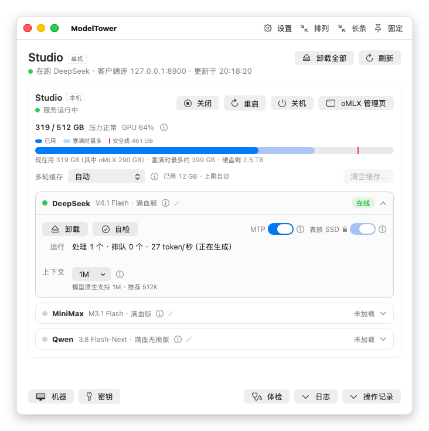
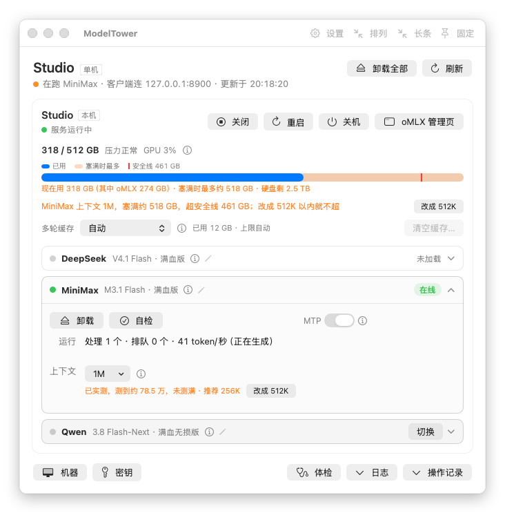
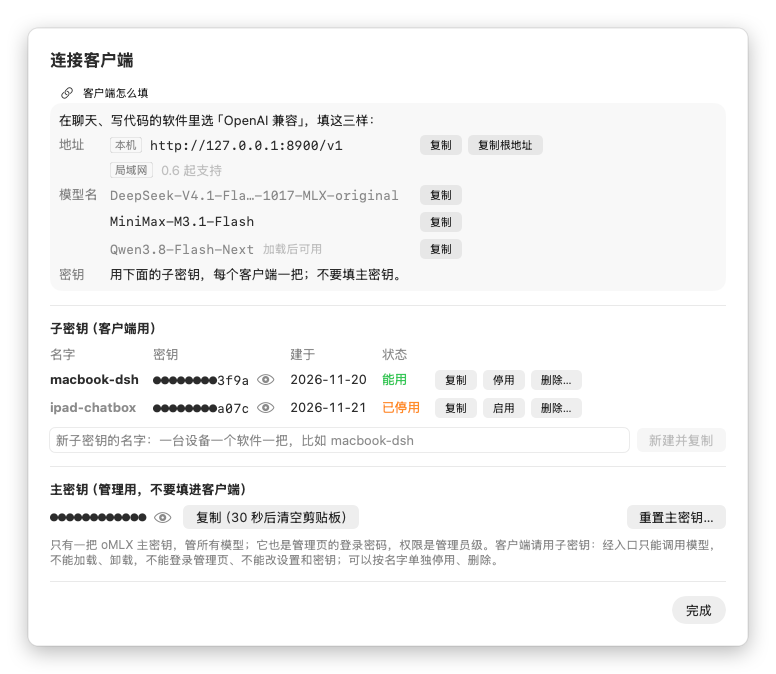

# ModelTower · 模型塔台

**在自己的 Mac 上跑开源大模型，一个窗口全管好。**

装引擎、挑模型、一键加载、自动自检、给客户端发钥匙，不用敲命令。 模型在本机跑，对话不出这台 Mac。

  

[English](README.md) · [操作指南](docs/guide.zh-CN.md) · [常见问题](docs/faq.zh-CN.md) · [更新记录](CHANGELOG.md)

主窗口（图中数字是示例）。实测：512 GB 的 Mac Studio（M3 Ultra）上，DeepSeek V4.1 Flash 满血版约 330 GB，53 秒加载完并通过自检。

## 核心功能

### 🧭 一键加载，先算好账

- **认出已有的模型**：这台上已有的模型自动列出；放在别的文件夹的，选一下文件夹就加进来。
- **加载、卸载、切换**：在模型卡片上点一下。放不下一起跑时，按钮会变成「切换」，先卸载别的再加载。
- **加载前就告诉你**：要占多少内存、大概要多久、这台放不放得下。
- **内存一目了然**：内存条显示现在用了多少、对话塞满上下文时最多会到多少、安全线在哪。快超线时写明原因和改法，一键就能改小上下文。

### ⚡ 跑得快，也装得下

每个模型单独设，按 oMLX 报的能力显示，模型支持才出现。每个开关旁边的 ⓘ 写着收益、代价和什么时候该开。

- **MTP（多 token 预测）**：模型先一次猜出后面几个字，再一起核对，猜对的直接用，答案逐字不变。写代码、思考、长回答时提速最明显。
- **表放 SSD**：把模型的查询表留在 SSD 上按需读取，答案不变，能省下一大块内存。内存紧、要和别的大程序一起跑时打开。
- **上下文**：按档位选。塞满会超安全线时提前提醒，告诉你改到多少就不超。
- **多轮缓存**：把聊过的内容存到硬盘，下一轮不用从头算。可以选自动、设上限或者关掉。

### ✅ 心里有底

- **自检**：模型加载完，先让它答一道题，答对了才算好；有问题当场就知道，不用等到客户端报错。
- **体检**：一键逐项检查服务、端口和权限，哪一项不对就写明原因。
- **操作记录和日志**：每一步做了什么、花了多久，都查得到。

### 🔑 接上你常用的软件

- **「连接客户端」页**：地址、模型名、密钥一页写清，都能一键复制。聊天、写代码的软件选「OpenAI 兼容」就能用，网页版和 Electron 做的客户端也能连。
- **每个客户端一把子密钥**：随时停用、启用或删除，互不影响。
- **入口把门**：只放行已经加载的模型，客户端没法顺手加载别的模型、把内存挤爆。

### 🌏 在哪都能顺利装好 oMLX

- **按网络环境选下载源**：海外走 GitHub 官方发布页，中国大陆走魔搭转存；选「自动」时先测速，挑快的那边下载。
- **手里已经有安装包**：选一下就能用，不用重新下载。
- **下载后先核对**：不管从哪下，都按兼容表里的 SHA-256 核对，一个字节对不上就不装。oMLX 出了新版，控制台先核对过再提示你升级。

## 看一眼

**塞满上下文会超安全线？先告诉你原因，点「改成 512K」就不超**

**「连接客户端」页：地址、模型名、子密钥一页写清，每个客户端一把钥匙**

## 三步上手

1. **下载**：到 [Releases](https://github.com/dan-cube/modeltower/releases) 下载最新版的 zip，解压后把 ModelTower 拖进「应用程序」。旁边的 `.sha256` 可以用来核对文件。
2. **第一次打开**：应用没有经过苹果公证，系统会拦一次。到「系统设置 → 隐私与安全性」，在 ModelTower 那一行点**仍要打开**，之后就能正常双击。
3. **跟着「开始使用」走**：装 oMLX（GitHub、魔搭任选，或者用你已经下好的安装包）→ 认出已有的模型（没有就在 oMLX 里下一个）→ 挑一个，点「加载并自检」。

然后在聊天、写代码的软件里选「OpenAI 兼容」，填上「连接客户端」页给的三样：

| 填什么 | 写什么 |
|---|---|
| 地址 | `http://127.0.0.1:8900/v1`（页面上点「复制」） |
| 模型名 | 页面上列出的、已经加载的模型 |
| 密钥 | 给这个客户端新建的子密钥 |

每一步的细节见[操作指南](docs/guide.zh-CN.md)。

## 要求

- Apple Silicon 的 Mac（M1 起），macOS 15 或更新。这是 [oMLX](https://github.com/jundot/omlx) 的要求，以它的说明为准。
- 内存够放你要跑的模型。应用会按这台的内存标出哪些放得下。
- 没装 oMLX 也没关系，第一次打开时会带你装。

## 路线图

| 版本 | 带来什么 | 状态 |
|---|---|---|
| **0.5** | **单机**：一台 Mac 自己跑模型，给本机的软件用 | ✅ 可用 |
| **0.6** | **局域网**：家里、办公室的电脑和手机直接用这台的模型，每台设备一把钥匙 **外网**：借 Tailscale、蒲公英、EasyTier 这类组网软件，人在外面也能安全地连回来 | 🔜 下一版 |
| **1.0** | **联机**：家里的几台 Mac 在一个窗口里一起管，每台加载不同的模型，一键启停所有机器；配对时核对指纹，不经手对方的密码；随时吊销，按需给权限 | 🗺️ 规划中 |
| **管理版** | 用不跑模型的 Mac（比如 MacBook）远程管理你的模型主机：看状态、加载和切换模型、发钥匙 | 💡 规划中 |

路线会按大家的反馈调整。

## 本地运行，隐私放心

模型在你自己的 Mac 上跑，对话和文件不经过任何云端。ModelTower 不收集数据、不上报、不用注册账号；它自己只在下载 oMLX 和每天查一次更新时联网，只读，不上传。

<b>联网细节</b>

- **下载 oMLX 安装包**：从 GitHub 或魔搭下载。下载源选「自动」时，先连一下两边测速度。
- **检查更新**：默认开，一天一次，读一份签了名的小文件，里面是 oMLX 兼容表、ModelTower 的最新版本和通知。这份文件放在本仓库（GitHub）和魔搭转存两处，一处读不到就读另一处；都读不到也不影响使用。签名对不上就不认。只读，不上传任何东西，在「设置 → 更新」里能关。
- 其余都在本机：控制台和 oMLX、入口之间只走 `127.0.0.1`。联网时按系统的代理设置走。
- **主密钥**：控制台只记你允不允许它读 oMLX 的主密钥，不保存密钥，每次用时现读。
- oMLX 自己的联网（下载模型、它自带的自动更新）归 oMLX 管。

## 其他说明

- 只对接官方 oMLX，也就是官方安装包或 Homebrew 装的。
- 模型不随本应用发布，要在 oMLX 里从 Hugging Face 或魔搭下载。模型各有各的许可证，用之前请看清。
- 界面有简体中文和 English，默认跟随系统。

## 依赖和致谢

- **[oMLX](https://github.com/jundot/omlx)**（Apache-2.0）是真正运行模型的引擎。ModelTower 不捆绑它，只对接它的官方安装包。谢谢 oMLX 的作者和贡献者。
- **[Apple MLX](https://github.com/ml-explore/mlx)**（MIT）：oMLX 靠它在 Apple Silicon 上跑模型。
- **[魔搭转存](https://www.modelscope.cn/models/skyeyes1999/omlx-release-copy)**是 oMLX 官方安装包在魔搭上的原样转存，附 oMLX 的 LICENSE 和 `SHA256SUMS`。它**不是 oMLX 官方的**，和 oMLX 项目没有关系。

## 反馈

问题和建议请提到本仓库的 [Issues](https://github.com/dan-cube/modeltower/issues)。oMLX 本身的问题请提到 [oMLX 的仓库](https://github.com/jundot/omlx)。贴日志前请先删掉里面的密钥。

## 许可证

ModelTower 以 [Apache License 2.0](LICENSE) 发布，© 2026 dan-cube，见 [NOTICE](NOTICE)。

oMLX、Apple MLX 和各个模型不随本仓库发布，各自适用自己的许可证（oMLX：Apache-2.0；MLX：MIT；模型：见各模型页面）。
