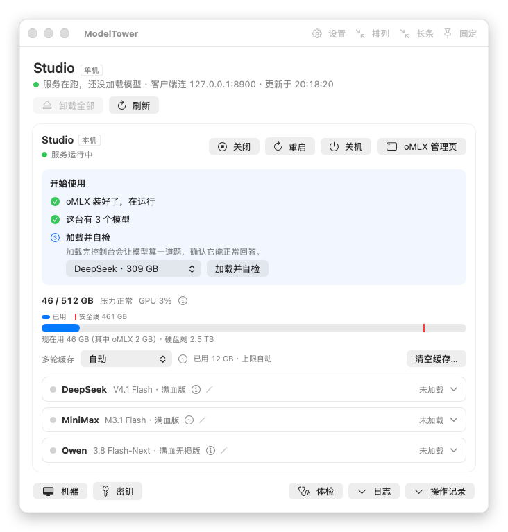
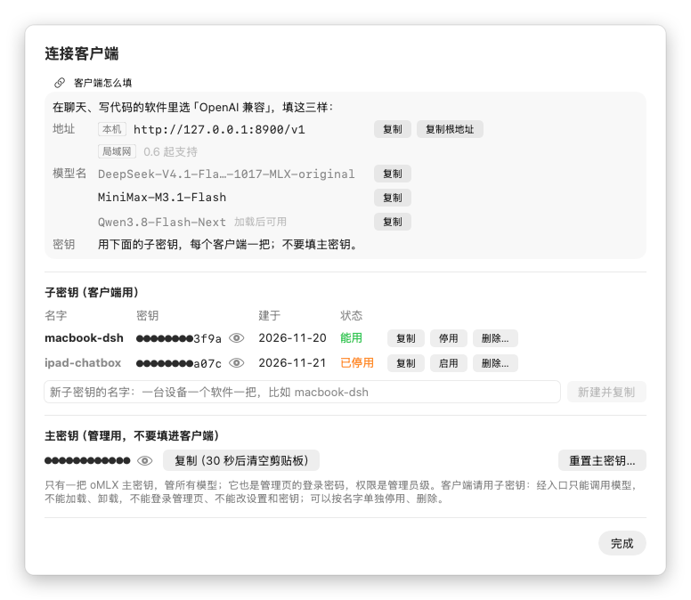
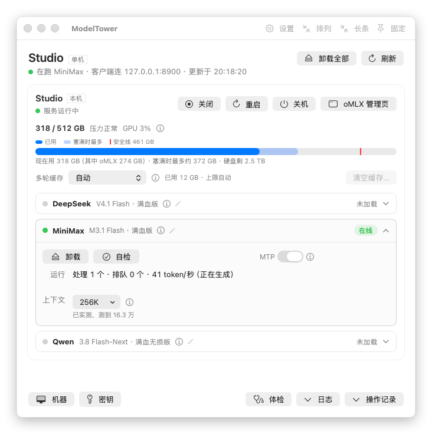
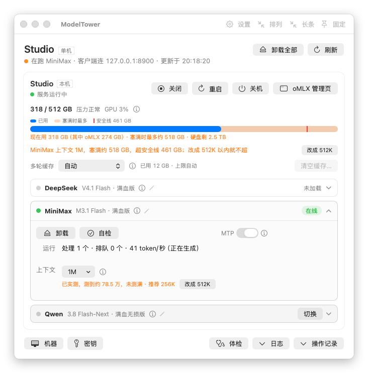
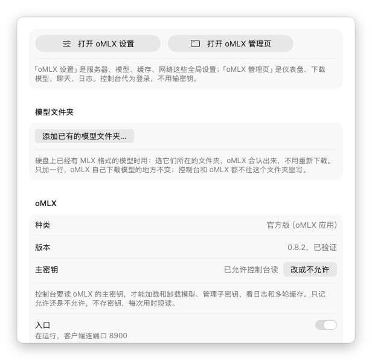

# ModelTower Guide

[简体中文](guide.zh-CN.md) · [FAQ](faq.en.md) · [Back to the front page](../README.md)

For ModelTower 0.5.1. This guide follows the order you will actually go through: opening the app for the first time → getting one model running → connecting a client → daily use → updates → shutting down and uninstalling.

0.5.1 supports a **single Mac** only: one Mac runs the models for itself. Using this Mac's models from other devices on your local network comes in 0.6; linking several Macs together comes in 1.0 (see [section 7](#7-linking-macs-a-preview)).

A few terms first:

- **oMLX**: the program that actually runs the models. It is a separate open-source project. ModelTower is its switchboard and dashboard.
- **Console**: the ModelTower app itself. Wherever the interface says "console", it means this app.
- **Main key**: oMLX's main key. It can manage everything. It is for the console only; never put it into a client.
- **Sub-key**: a key you give to a client. It can only call models, and can be disabled or deleted.
- **Gateway**: a door between clients and oMLX. It checks sub-keys and lets through only models that are already loaded.

## 1. Opening it for the first time

ModelTower is not notarized by Apple. macOS blocks it the first time. Approve it once and it will not ask again.

1. Drag ModelTower into Applications and double-click it. The system says the developer cannot be verified. Click **Done** or **OK** to close that dialog.
2. Open **System Settings → Privacy & Security** and scroll down to **Security**. You will see a line saying ModelTower was blocked. Click **Open Anyway** next to it.
3. Confirm with your Mac password or Touch ID. From then on, double-clicking opens it normally.

If the system asks whether ModelTower may access the **Local Network**: 0.5.1 only uses this one Mac and does not need it, so you can decline. You can change it later in **System Settings → Privacy & Security → Local Network**.

## 2. Get Started: three steps to a running model

The first time you open the app, the window shows a **Get Started** panel with three steps. The button for the step you are on is highlighted. When all three are done, the panel hides itself.

Screenshots show the Chinese interface, with sample numbers; the app also comes in English.

### Step 1: Install oMLX

Click **Install oMLX…** to open the install window. There are three ways; pick one:

- **Download the Official Installer (Recommended)**: click **Download**. The console downloads from the **Source** shown in the window, then checks the size and SHA-256 against its compatibility table. If they do not match, the file is deleted and not opened. The installer is about 900 MB, and an interrupted download resumes.
  - The **Source** follows **Settings → Updates → Download Source** by default (see [section 8](#8-updates-and-download-source)): GitHub (oMLX's official release page), or the ModelScope mirror for mainland China. When both sources are available, you can also change it right in the install window.
  - If the download will not move, click **Open release page** in the window: download it in your browser from the official release page, then use **I Already Downloaded It** below.
  - When it is ready, click **Open Installer** and, in the window that appears, **drag oMLX into Applications**. You do not need to come back and click anything: the console connects by itself once oMLX is installed.
- **Install with Homebrew**: the window shows the commands. Copy them into Terminal and run them. If Homebrew is not installed, this option tells you to get it from brew.sh first.
- **I Already Downloaded It**: click **Choose Installer…** and pick the `.dmg` you downloaded (from GitHub, ModelScope or anywhere else). The console verifies it first. If it is not a supported version, it tells you which version this is and which one to download.

Once oMLX is installed, the console does three things:

1. **Checks the official signature.** The console does not connect to an oMLX that is not signed by its developer, and asks you to delete it and reinstall.
2. Asks whether to **turn off oMLX's own auto-update**. By default oMLX downloads new installers of about 900 MB in the background, and those versions have not been verified by the console. We suggest clicking **Turn Off**; from then on the console's **Updates** page tells you about new versions. You can restore this at any time.
3. Starts oMLX, then asks whether to **allow the console to read this Mac's oMLX main key**.

About the main key question:

- **Allow**: the console can list models, load and unload them, manage sub-keys, and show logs and the cache.
- **Don't Allow**: the console can only show status.
- The console only remembers whether you allowed it. It **never stores the key** and reads it fresh each time. You can change this later in **Settings → oMLX**.

### Step 2: Get your models ready

The title of this step shows how many models this Mac has (or **Download a model** when there are none yet). Models already on this Mac show up in the list by themselves. Two other cases:

- **Your models are in another folder** (an external drive, say, or downloaded earlier by another app): click **Add an Existing Model Folder…** and pick the folder in Finder. oMLX recognizes the MLX-format models in it, so there is nothing to download again.
  - It only adds one more model folder to oMLX: where oMLX downloads models stays the same, and neither the console nor oMLX writes anything into the folder you picked.
  - If a model is online, you are asked first: changing oMLX's model folders unloads any loaded models.
  - The same button is also in the **Model Folders** section of **Settings → oMLX**.
- **You have no models yet**: click **Open the oMLX Admin Page** and download one on oMLX's own admin page. The console signs in for you, so you do not need to enter a key.
  - This step shows this Mac's memory and a suggested maximum size for an MLX-format model. Staying within it leaves room for conversations after loading.
  - In mainland China: choose ModelScope on oMLX's model download page. It is built into official oMLX.
  - When the download finishes, come back to ModelTower. The model appears by itself; no restart needed.

If this step shows **Allow Reading the Main Key…** instead, you chose Don't Allow in the previous step. Without it, the console cannot see which models this Mac has. Click it to choose again.

### Step 3: Pick a model, load it and self-test

- When this Mac has several models, this step has a menu; each item reads "name · size in GB". Models this Mac does not have the memory for end in "· too big", and choosing one shows an orange note below.
- The first one that fits is selected by default; you can pick another.
- Click **Load and self-test**. A large model takes a few minutes. After loading, the console asks the model one question to confirm it answers properly.
- Once it passes, the Get Started panel hides itself. To see it again, go to **Settings → Guide** and click **Show “Get Started” Again**.

## 3. Connecting a client

A client is the software you chat or write code with. Click **Keys** in the bottom-left corner to open the **Connect Clients** page. It has three parts, top to bottom:

### What to Enter in a Client

In your chat or coding app, choose "OpenAI compatible" and fill in three things:

| Field | Where to find it |
|---|---|
| **Address** | This Mac's address on the page, `http://127.0.0.1:8900/v1`. Click **Copy** next to it. Some clients (Chatbox and Cherry Studio, for example) want the address without `/v1`: click **Copy Root Address** |
| **Model name** | This Mac's models, one per line, each with **Copy**. Only loaded models work; the others are greyed out and say "available once loaded" |
| **Key** | One of the sub-keys below, one per client; don't use the main key |

**This address only works on this Mac**: the client has to run on this Mac. That is what the grey line under the address (**Local network**, Supported from 0.6) means: connecting from other computers or phones on your local network comes in 0.6.

Web-based clients opened in a browser on this Mac, and desktop clients built with Electron, can connect through the Gateway too.

### Sub-keys (for clients)

The table has one row per sub-key: Name, Key (hidden except for the last few characters), Created, and Status (**Active** or **Disabled**).

- **Create**: type a name in the box at the bottom (one per device and app, anything you will recognize) and click **Create and Copy**. The new sub-key appears in the table and is already copied, ready to paste into a client. Through the Gateway it can only call models: it cannot load or unload them, sign in to the admin page, or change settings.
- **See the full key**: click 👁. The full key is shown for 10 seconds and copied to the clipboard, and the clipboard clears after 30 seconds.
- **Copy**: copies this key so you can paste it into a client.
- **Disable / Enable**: to stop a client for now, click **Disable**; click **Enable** later to bring it back with the same key. Disabling is done by the Gateway, so it has no effect while the Gateway is off. In that case the button is greyed out, and its note says that to stop a key, you have to delete it.
- **Delete…**: removes this key from oMLX. This cannot be undone, and you are asked first. Delete a key when its client is no longer used or the key may have leaked; only that key is affected.

### Main key (for management; never put it into a client)

- Hidden by default. Click 👁 to see it, or **Copy (clipboard clears after 30 s)** to copy it. You only need it to sign in to the oMLX admin page yourself.
- **Reset Main Key…**: replaces it with a new main key.

### About the Gateway

- With official oMLX, the Gateway is on by default. Clients connect to the Gateway (port 8900 by default), not directly to oMLX (port 8000 by default).
- The Gateway **lets through only models that are already loaded**. A client asking for a model that is not loaded is refused, rather than silently loading it and filling up memory.
- The Gateway's status is in **Settings → oMLX**. You can turn it off; before it does, the console spells out what follows: clients must connect to oMLX's own port instead, models that are not loaded can be started by a client request, and disabling sub-keys stops working.
- If the Gateway is not running, click **Start Now**.

When a client reports an error, check two things first: that the model is loaded (the card says Online), and that the address and model name were copied from the Connect Clients page.

## 4. Reading the main window

### The title area at the top

Two lines on the left:

- Line one: this Mac's name, followed by **Single Mac**.
- Line two: a status dot, then what is running ("Running ××"; or "Service running, no model loaded yet", "oMLX is starting…", "oMLX isn't running") · the address clients connect to · when it was last updated.

Two buttons on the right: **Unload All** (unloads every model; the service keeps running) and **Refresh**.

The status dot: green, all is well; orange, there is a warning (for example memory would go over the line if the context filled up); red, something is wrong (for example memory is already over the line, or the service is stuck). The details are in the banner below.

### Top-right corner

From left to right:

- **Settings**: the console's settings. See [section 6](#6-settings).
- **Arrange**: changes how the cards are laid out.
- **Mini Bar**: collapses the window into a floating bar and hides the main window. Click the button at the right end of the bar to expand it again.
- **Pin**: pins the main window: it stays in front of other windows and cannot be dragged; the console's own settings, install window and admin page float above it. Click again to unpin. It is still pinned the next time the console opens.

### Machine card

- The name is tagged **This Mac**, with the service status below it (for example "Service running"). The **dot** before the name: green, the service is running; red, the Mac is on but the service is not running or is stuck; orange, changing.
- **Memory bar**: a legend above it with three items: **Used**, **Most when full** (the most it may reach when conversations fill the context), and **Safety line** (90% of total memory, for example 461 GB on a 512 GB Mac). The light part turns orange when a full context would go over; the dark part turns red when it is already over.
- The line under the bar gives three numbers, all for the **whole Mac**: "Using X GB now (oMLX Y GB of it) · at most about Z GB when full · W disk free". The numbers have an ⓘ: **Pressure** is macOS memory pressure, and **GPU** is how busy the GPU is right now.
- **When it would go over the safety line**, another line gives the reason and the fix, for example "MiniMax context 1M, about 518 GB when full, over the 461 GB safety line; at 512K or less it stays under", with a **Change to 512K** button next to it that makes the change. See [section 5](#5-loading-unloading-switching-models-and-the-switches).
- The oMLX admin page shows a red line about the GPU memory limit. **You can ignore it**: the console's safety line (90% of total memory) is already below the system's default limit.
- Buttons:
  - **Start**: starts this Mac's oMLX without loading a model.
  - **Stop**: like ⌘Q, stops the oMLX service and then quits the console (you confirm first).
  - **Restart**: restarts oMLX; when you confirm, you can choose to load the models back.
  - **Shut Down**: see [section 9](#9-shutting-down).
  - **oMLX Admin**: opens this Mac's own oMLX web admin page (dashboard, models, chat, logs), signed in for you.
- **Cache**: this Mac's multi-turn cache limit, shared by all models. See [section 5](#5-loading-unloading-switching-models-and-the-switches).

### Model card

- Status: **Not Loaded**, **Loading…**, **Online**. Click the arrow on the right to expand the card.
- **Running** (when online): how many requests are being processed and queued, and the speed in tokens/s while generating.
- Buttons: **Load** (or **Switch**), **Unload**, **Self-test**.
- **Context**: how much a single conversation can hold.
- **MTP** and **Tables on SSD**: only for models that support them; see [section 5](#5-loading-unloading-switching-models-and-the-switches).
- The **ⓘ** in the card header: notes on this model, and the model name to enter in a client.
- The pencil in the card header: edit this model's name and notes on this Mac.

### The bottom row

- **Machines**: change the order and names of cards. **Add Machine** and **This Mac's Access** open preview pages about linking Macs; see [section 7](#7-linking-macs-a-preview).
- **Keys**: connect clients; see [section 3](#3-connecting-a-client).
- **Health Check**: checks things one by one and tells you what is wrong. When something goes wrong, click this first.
- **Logs**: oMLX's own records. **Activity**: what this window has done.

**Menu bar icon**: shows a one-line status, and lets you load, unload, open the console window, and quit.

### Closing the window is not the same as quitting

- **The red close button only hides the window.** The service and models keep running, and clicking the Dock or menu bar icon brings it back. The first time you click the red button after opening the console, a note says "The window is hidden; the console is still running"; tick **Don't show again** and it will not appear again.
- **Only ⌘Q quits**: it stops the oMLX service first (the models are unloaded with it), then quits the console. The oMLX app's own icon stays in the menu bar with its service stopped; with Homebrew, its background service is stopped. You are asked to confirm first, and told how many requests are still being processed.
- To make the red button quit: turn on **Quit the console when closing the window** in **Settings → General** (off by default). After that, the red button asks for the same confirmation as ⌘Q.

Confirmation dialogs usually drop down from the main window; when the window is hidden or shown as the Mini Bar, and when you quit with ⌘Q, they appear in the middle of the screen.

## 5. Loading, unloading, switching models, and the switches

**Load**: click **Load** on a model card. Below the button it says how much memory it needs and whether it fits:

- "This Mac is empty and can load right away";
- "Fits, runs together with ××";
- it does not fit and can only be switched in, unloading ×× first. In that case the button says **Switch**; clicking it unloads the other model, then loads this one.

**Unload**: click **Unload**. If requests are still being processed, the console tells you how many and waits for them to finish before unloading. **Stop Waiting** appears at the top; clicking it cancels the unload and the model stays online.

**Self-test**: click **Self-test** to send one question and confirm the model can answer. It is available only after loading.

**Context**: click the context item on the model card and pick a size.

- The default: if you set a context for this model in oMLX, that is used; otherwise it is 256K, or the model's own maximum if that is smaller.
- For some models the change takes effect immediately; for others it takes effect at the next load. The text under the options says which.

**Cache** (on the machine card): stores earlier turns of a conversation on disk so the next turn does not recompute them.

- Choose **Auto**, pick a limit, or turn it off. Off means nothing is written to disk. After picking a fixed limit you can still go back to **Auto**.
- **Auto** uses oMLX's own rule: the limit is (free disk space + existing cache) ÷ 2, so it is larger when there is more free disk, and it changes over time. The ⓘ next to it says the same.
- Changing it does not restart the service, but models are unloaded and loaded back.
- **Clear Cache…**: deletes this Mac's cache. You must unload this Mac's models first.

**Model switches** (only for models that support them):

- **MTP (multi-token prediction)**: the model drafts several tokens ahead and verifies them together, keeping the ones that match. The output is identical. The speed-up is biggest when it writes a lot: code, reasoning, long answers.
- **Tables on SSD**: keeps the model's lookup tables on the SSD and reads them on demand. The output is identical and it frees up a large chunk of memory. Off by default, as in oMLX. When this Mac does not have the memory and oMLX itself forces the tables onto the SSD, the switch is locked on and says "Doesn't fit, so oMLX keeps it on the SSD".
- Greyed out: this Mac's oMLX says the model does not support it. Hover over it to see why.
- Free to flip: while the model is not loaded, the change is saved and takes effect at the next load. While it is online, it takes effect only after reloading, so the console first asks whether to **Switch** or cancel, and says how many requests would be interrupted right now.

The **ⓘ** next to each switch explains what it is, its benefits and costs, and when to turn it on.

**Over the memory limit**: when a full context could go over the safety line, the warning gives the reason and the fix, for example "context 1M, about 518 GB when full, over the 461 GB safety line; at 512K or less it stays under", and **Change to 512K** next to it makes the change in one click. The button is under the memory bar on the machine card and on the context row of the model card. If **Tables on SSD** is available and off, the warning adds ", or turn on Tables on SSD". You can also unload a model.

## 6. Settings

Click **Settings** in the top-right corner. Tabs: **General / Updates / Guide / About / oMLX**.

- **General**: language, opening the console when you log in, quitting the console when closing the window.
- **Updates**: oMLX's version and upgrades, download source, online check. See [section 8](#8-updates-and-download-source).
- **Guide**: a short built-in guide, and **Show “Get Started” Again**.
- **About**: the version number, the license (Apache-2.0) and this project's GitHub address.
- **oMLX**: two buttons at the top:
  - **Open oMLX Settings**: opens the settings page of oMLX's web admin page directly. All of oMLX's settings (server, models, cache, network, authentication and more) are changed there.
  - **Open oMLX Admin**: opens the admin page's home, with the dashboard, models, chat and logs; you can also download models there.
  - Below them is the **Model Folders** section, where **Add an Existing Model Folder…** also lives.
  - Further down is this Mac's oMLX status: which kind of install (for example the official oMLX app), the version, whether the console may read the main key (you can change it), and the Gateway (its switch and port).

The oMLX app also has its own settings window in the menu bar, which changes the same settings. The console does not open it; everything can be changed on the web admin page.

## 7. Linking Macs: a preview

In 0.5.1, **Add Machine** and **This Mac's Access** under **Machines** each open a preview page describing what linking Macs will let you do:

- **Add Machine**: connect the Macs at home into a group and manage them in one window, seeing each one's memory, speed and what it is running, with a different model on each; start, stop, restart or shut down every Mac with one click; pairing checks a fingerprint and a check code, without handling the other Mac's password.
- **This Mac's Access**: manages who can control this Mac. Another Mac sends a pairing string, you check it and click Allow, and you can revoke access at any time; when allowing, you choose how much access to give (call models only, view status only, operate, or manage).

Linking Macs comes in **1.0**. Stay tuned.

**Using this Mac's models from other devices on your local network** (a chat app on another computer or a phone connecting to this Mac): **comes in 0.6**. In 0.5.1 the client address only works on this Mac.

## 8. Updates and download source

Everything here is in **Settings → Updates**.

**The oMLX row** shows the current version and its status.

- When a verified newer version exists, it says "Can upgrade to ××". Click **Upgrade…**.
- The upgrade window has three steps: **Back Up Settings, Download the New Version** → **Quit oMLX and Replace It with the New Version** → **I've Replaced It, Run Self-Test**.
- You replace the app yourself: click the oMLX icon in the menu bar and choose Quit oMLX, then open the installer and drag the new version into Applications, replacing the old one.
- If every check passes, the upgrade is done. If any fail, the settings backup made before the upgrade is still there; its path is shown in step 1.
- If a test build of oMLX is installed (0.8.0rc1, for example), this row says "Test build, please upgrade to the release".

**oMLX's own auto-update**: you can **Turn Off…** or **Restore** it here.

**Online Check** (on by default): once a day the console reads one small signed file containing the oMLX compatibility table, the latest ModelTower version and notices. If the signature does not match, the file is ignored. It only reads; nothing is uploaded.

- The file is kept in two places: this repository (GitHub) and the ModelScope mirror. If one cannot be reached, the console tries the other; which one comes first follows the download source.
- When it gets through: a newer oMLX that has been verified shows up in the oMLX row as an upgrade. A newer ModelTower is shown too, with a **Download Page** link (this repository's Releases); you download and replace the app yourself.
- When it cannot get through, nothing stops working: the console uses the compatibility table that ships with the app.
- It uses the system proxy settings. If you would rather it stayed offline, turn it off.

**Download Source** (where the oMLX installer comes from):

- **Auto**: when both sources are available, read a small piece from each to test the speed, and use the faster one.
- **International**: GitHub only.
- **China**: the ModelScope mirror only. To download models, choose ModelScope on oMLX's model download page; it is built into official oMLX.
- With **China** selected, one more checkbox appears: switch oMLX's Hugging Face address to a community mirror. It is a community mirror run by an individual, with no official guarantee, and it is off by default. Use ModelScope first, and tick this only for models ModelScope does not have. You can untick it at any time, or click **Restore the Hugging Face Address**.

### Downloads for China: the ModelScope mirror

oMLX publishes its installers only on GitHub, which is often slow from mainland China. So this project keeps an **unmodified copy** on ModelScope:

- Address: <https://www.modelscope.cn/models/skyeyes1999/omlx-release-copy>
- What is in it: the official oMLX installers for the version in the compatibility table (one for macOS 15, one for macOS 26, such as `oMLX-0.8.2-macos15-sequoia.dmg` and `oMLX-0.8.2-macos26-27.dmg`), not a single byte changed, plus oMLX's LICENSE and a `SHA256SUMS` file.
- How you know it was not altered: whether the console downloads from GitHub or ModelScope, it checks the SHA-256 in the compatibility table and refuses to install if a single byte differs. A second source therefore adds no extra risk.
- Downloading by hand: download from the address above, run `shasum -a 256 FILENAME`, and if it matches `SHA256SUMS`, use **I Already Downloaded It**.
- This mirror is **not official** and is not affiliated with the oMLX project.

## 9. Shutting down

**Shutting down this Mac**: click **Shut Down** on the machine card. The console stops oMLX first, then shuts the Mac down.

- After you confirm, use Touch ID or type your Mac password once more. No setup is needed beforehand.
- This window closes with it.
- After a shutdown, press the power button to start the Mac again.

**If a confirmation dialog appears when you did not click anything, do not confirm it.**

## 10. Uninstalling

ModelTower and oMLX are two separate apps and are removed separately. Model files belong to oMLX; removing ModelTower does not touch them.

**Removing ModelTower**:

1. In **Settings → General**, turn off opening the console when you log in (only if you turned it on).
2. Press ⌘Q to quit. This stops the oMLX service and unloads the models.
3. Drag ModelTower from Applications to the Trash.
4. To remove its settings too: in Finder press ⇧⌘G, go to `~/Library/Application Support/ModelTower/`, and delete that folder. It holds the console's settings, downloaded oMLX installers, logs and the Gateway's settings.

For anything else that may be left behind, see the [FAQ](faq.en.md#how-do-i-uninstall-completely).

**Removing oMLX**: follow oMLX's own instructions. If you only drag oMLX to the Trash, its settings and model files remain.
