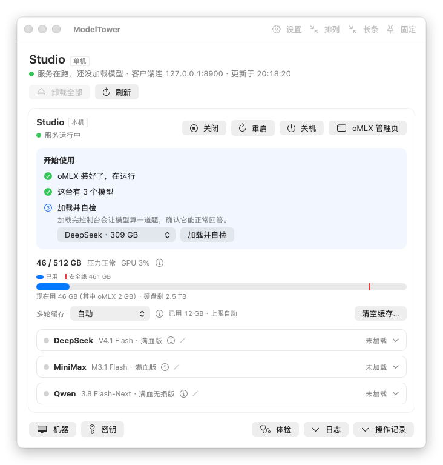
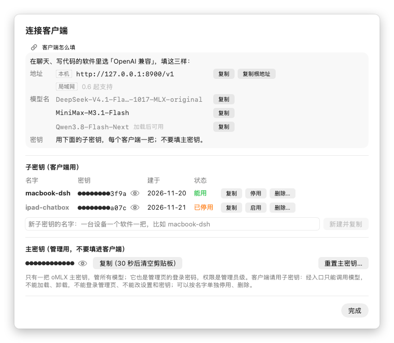
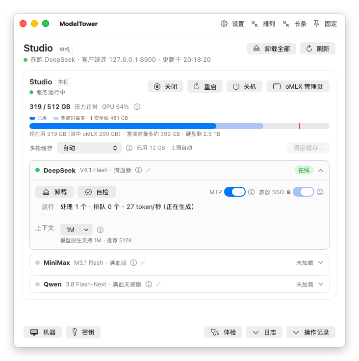
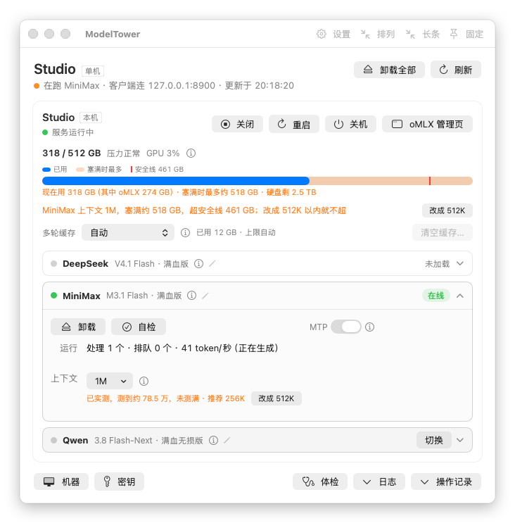
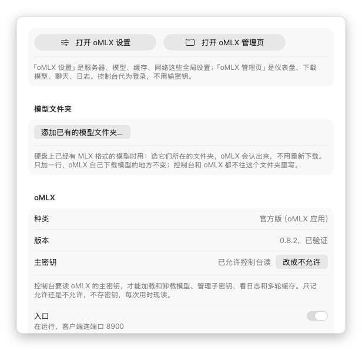

# ModelTower 操作指南

[English](guide.en.md) · [常见问题](faq.zh-CN.md) · [回到首页](../README.zh-CN.md)

适用于 ModelTower 0.5.2。按你实际会走的顺序写：第一次打开 → 跑通一个模型 → 连上客户端 → 日常使用 → 更新 → 关机和卸载。

0.5 只支持**单机**：一台 Mac 自己跑模型、自己用。局域网里别的设备调用这台的模型 0.6 起支持；多台 Mac 联机在 1.0 推出（见[第 7 节](#7-联机预告)）。

几个词先说清：

- **oMLX**：真正运行模型的程序，单独的开源项目。ModelTower 是它的开关和仪表盘。
- **控制台**：就是 ModelTower 这个应用。界面里写的「控制台」都指它。
- **主密钥**：oMLX 的总钥匙，能管理一切。只给控制台用，不要填进客户端。
- **子密钥**：发给客户端的钥匙，只能调模型，能停用、能删。
- **入口**：客户端和 oMLX 之间的一道门。它认子密钥，只放行已经加载的模型。

## 1. 第一次打开

ModelTower 没有经过苹果公证（公证要付费加入苹果开发者计划）。macOS 第一次会拦住它，这是正常的，放行一次就行，以后不再问。

1. 把 ModelTower 拖进「应用程序」，双击打开。系统会说无法验证它，点「完成」或「好」关掉这个框，**别点「移到废纸篓」**。
2. 打开「系统设置 → 隐私与安全性」，往下滚到「安全性」一栏，会看到一行说 ModelTower 被拦了，点旁边的**仍要打开**。
3. 输入 Mac 密码或按指纹确认。之后再双击就能正常打开。

「仍要打开」只在被拦后一小时内出现，没看到就再双击一次 ModelTower。点了「移到废纸篓」、想先核对文件，见[常见问题](faq.zh-CN.md#双击打不开系统说无法验证还让我移到废纸篓)。

如果系统问要不要允许 ModelTower 访问**本地网络**：0.5 只用这一台 Mac，用不到，可以不允许。以后在「系统设置 → 隐私与安全性 → 本地网络」里能改。

## 2. 开始使用：三步跑通一个模型

第一次打开，窗口里有一块**开始使用**，列着三步。做到哪一步，哪一步的按钮就亮着。三步做完，这一块自己收起。

截图里的数字是示例。

### 第 1 步：安装 oMLX

点**安装 oMLX…**，打开安装窗口。有三条路，选一条：

- **下载官方安装包（推荐）**：在「从哪里下载」里选一个，点**下载**。下完按兼容表核对大小和 SHA-256，对不上就删掉、不打开。安装包约 900 MB，断了能接着下。
  - **从哪里下载**有两项：**GitHub**（oMLX 官方发布页）、**魔搭**（本项目开发者的原样转存，供中国大陆下载）。两个是同一份官方安装包。先选中哪一项跟着「设置 → 更新 → 下载源」走（见[第 8 节](#8-更新和下载源)）；下载源是「自动」时多一项**自动**，下载时测速挑快的。
  - 下不动的话，点窗口里的**打开发布页**：用浏览器到官方发布页手动下好，再走下面的「我已经下载好了」。
  - 下好后点**打开安装包**，在弹出的窗口里**把 oMLX 拖进「应用程序」**。不用回来点任何东西，装好后控制台会自己接上。
- **用 Homebrew 装**：窗口里给出命令，复制到「终端」里运行。没装 Homebrew 的话，这条路会提示你先去 brew.sh 装。
- **我已经下载好了**：点**选择安装包…**，选你下好的 `.dmg`（从 GitHub、魔搭或别处下的都行）。控制台先核对，不是适配的版本会说清是哪一版、该下哪一版。

装好后控制台会做三件事：

1. **核对官方签名**。不是官方签名的 oMLX，控制台不对接，会请你删掉重装。
2. 问你**要不要关掉 oMLX 自己的自动更新**。oMLX 默认会在后台下载约 900 MB 的新安装包，那些版本没经过控制台核对。建议点**关掉**，以后有新版由控制台的「更新」页提示。随时能还原。
3. 启动 oMLX，然后问你**允不允许控制台读这台 oMLX 的主密钥**。

关于主密钥这一问：

- 点**允许**：控制台才能列出模型、加载和卸载、管理子密钥、看日志和多轮缓存。
- 点**不允许**：只能看状态。
- 控制台只记你允许还是不允许，**不存密钥**，每次用时现读。以后可以在「设置 → oMLX」里改。

### 第 2 步：准备模型

这一步的标题写着这台有几个模型（还没有模型时写「下载一个模型」）。这台上已经有的模型，会自己出现在列表里。还有两种情况：

- **模型放在别的文件夹**（比如外接硬盘、以前别的软件下的）：点**添加已有的模型文件夹…**，在访达里选那个文件夹，oMLX 会认出里面的 MLX 格式模型，不用重新下载。
  - 只是给 oMLX 多加一个模型文件夹：oMLX 自己下载模型的地方不变，控制台和 oMLX 都不往你选的文件夹里写东西。
  - 有模型在线时会先问你：oMLX 改模型文件夹会卸载已经加载的模型。
  - 同一个按钮在「设置 → oMLX」的「模型文件夹」一节也有。
- **还没有模型**：点**打开 oMLX 的管理页**，在 oMLX 自己的管理页里下载。控制台代为登录，不用输密钥。
  - 这一步会写明这台的内存，和建议挑多大以内的 MLX 格式模型。照这个数挑，加载后还有余量放对话。
  - 在中国：在 oMLX 的模型下载页里选「魔搭」，这是官方 oMLX 自带的。
  - 下完回到 ModelTower，模型会自己出现，不用重启。

如果这一步显示的是**允许读主密钥…**，说明上一步你点了不允许：不允许的话控制台看不到这台有哪些模型。点它重新选一次。

### 第 3 步：挑一个模型，加载并自检

- 这台有几个模型时，这一步有个下拉框，每项写「名字 · 多少 GB」；这台内存放不下的，后面标「· 放不下」，选中它时下面会用橙字说明。
- 默认选中放得下的第一个，你可以换。
- 点**加载并自检**。大模型要等几分钟。加载完，控制台会让模型答一道题，确认它能正常回答。
- 通过后，「开始使用」这一块自己收起。想再看，到「设置 → 教程」点**再看一遍“开始使用”**。

## 3. 连上客户端

客户端就是你用来聊天、写代码的软件。点左下角**密钥**，打开**连接客户端**页。从上到下三块：

### 客户端怎么填

在客户端里选「OpenAI 兼容」，填三样：

| 填什么 | 写在哪 |
|---|---|
| **地址** | 页面上写的本机地址 `http://127.0.0.1:8900/v1`，点旁边的**复制**。有的客户端（比如 Chatbox、Cherry Studio）要不带 `/v1` 的地址，点**复制根地址** |
| **模型名** | 这台的模型一行一个，点旁边的**复制**。已经加载的才能用；没加载的灰着，写「加载后可用」 |
| **密钥** | 用下面的子密钥，每个客户端一把；不要填主密钥 |

**这个地址只在本机能用**：客户端要装在这台 Mac 上。地址下面那行灰字「局域网　0.6 起支持」说的就是这件事：局域网里别的电脑、手机连这台，0.6 起支持。

装在这台 Mac 上的网页版客户端、Electron 做的桌面客户端，经入口也能连。

### 子密钥（客户端用）

表里每把子密钥一行：名字、密钥（遮着，只露最后几位）、建于、状态（「能用」或「已停用」）。

- **新建**：在最下面的输入框里填个名字（一台设备一个软件一把，好认就行），点**新建并复制**。新的子密钥列进表里，同时已经复制好了，直接粘进客户端。经入口，它只能调用模型：不能加载、卸载，不能登录管理页，不能改设置。
- **看完整的密钥**：点 👁，完整密钥显示 10 秒，同时复制到剪贴板，30 秒后剪贴板自动清空。
- **复制**：复制这一把，填进客户端。
- **停用 / 启用**：哪个客户端暂时不让用，点**停用**；以后点**启用**就恢复，密钥不变。停用是在入口上做的：入口关着时停用不起作用，按钮灰着，提示写着「要停掉一把，只能删除它」。
- **删除…**：从 oMLX 里删掉这一把，不能恢复，会先问你。客户端不用了、或者钥匙可能泄露了，就删掉它，只影响这一把。

### 主密钥（管理用，不要填进客户端）

- 平时遮着。点 👁 能看，点**复制（30 秒后清空剪贴板）**能复制。只在你自己要登录 oMLX 管理页时用。
- **重置主密钥…**：换一把新的主密钥。

### 关于入口

- 装的是官方 oMLX 时，入口默认开着。客户端连的是入口（默认端口 8900），不是直接连 oMLX（默认端口 8000）。
- 入口**只放行已经加载的模型**。客户端点一个没加载的模型，会被拒绝，而不是悄悄把它加载起来把内存占满。
- 入口的状态在「设置 → oMLX」里看。能关，关之前控制台会说清后果：客户端要改连 oMLX 自己的端口，没加载的模型会被点起来，子密钥的停用也不起作用了。
- 入口没在运行时，点**现在启动**。

客户端报错时先看两样：模型是不是已经加载（卡片写着「在线」），地址和模型名是不是照「连接客户端」页抄的。

## 4. 主界面怎么看

### 顶部的标题区

左边两行：

- 第一行：这台的名字，后面标着**单机**。
- 第二行：最前面一个状态点，后面是在跑什么（「在跑 ××」；没加载模型写「服务在跑，还没加载模型」，正在起来写「oMLX 正在启动…」，没启动写「oMLX 没在运行」）· 客户端连的地址 · 更新时间。

右边两个按钮：**卸载全部**（卸载所有模型，服务保持运行）、**刷新**。

状态点：绿，都正常；橙，有提醒（比如塞满上下文时内存会超）；红，出了问题（比如内存已经超线、服务卡住）。提醒的具体内容在下面的横幅里。

### 右上角

从左到右：

- **设置**：控制台的设置，见[第 6 节](#6-设置)。
- **排列**：换卡片的排法。
- **长条**：把窗口收成一条浮动的长条，主窗口隐藏；点长条右边的按钮展开回来。
- **固定**：把主窗口钉住，总在别的窗口前面，也拖不动；控制台自己的设置、安装窗口和管理页会浮到它上面。再点一下取消。下次打开控制台还是钉着的。

### 机器卡片

- 名字旁标着**本机**，下面一行是服务的状态（比如「服务运行中」）。名字前面的**点**：绿，服务在跑；红，开着但服务没跑或卡住；橙，正在变。
- **内存条**：上方一行图例，三项：**已用**、**塞满时最多**（对话塞满上下文时最多会用到的）、**安全线**（总内存的 90%，比如 512 GB 的 Mac 是 461 GB）。塞满会超时浅色那段变橙；现在已经超了，深色那段变红。
- 内存条下面一行，三个数都是**整台 Mac** 的：「现在用 X GB（其中 oMLX Y GB）· 塞满时最多约 Z GB · 硬盘剩 W」。数字旁有 ⓘ：「压力」是 macOS 的内存压力，「GPU」是 GPU 此刻忙不忙。
- **会超安全线时**，下面另起一行写原因和改法，比如「MiniMax 上下文 1M，塞满约 518 GB，超安全线 461 GB；改成 512K 以内就不超」，旁边一个按钮**改成 512K**，点了就改好。见[第 5 节](#5-加载卸载切换模型和各个开关)。
- oMLX 管理页里有一行「显存上限」的红字，**可以不管**：控制台的安全线（总内存的 90%）本来就低于系统默认的上限。
- 按钮：
  - **启动**：启动这台的 oMLX，不加载模型。
  - **关闭**：和 ⌘Q 一样，停掉 oMLX 的服务，再退出控制台（先让你确认）。
  - **重启**：重启 oMLX；确认时可以选把模型加载回来。
  - **关机**：见[第 9 节](#9-关机)。
  - **oMLX 管理页**：打开这台 oMLX 自己的网页管理页（仪表盘、模型、聊天、日志），控制台代为登录。
- **多轮缓存**：这台的缓存上限，所有模型共用。见[第 5 节](#5-加载卸载切换模型和各个开关)。

### 模型卡片

- 状态：**未加载**、**加载中…**、**在线**。点卡片右边的箭头展开。
- **运行**（在线时）：正在处理几个请求、排队几个，正在生成时的速度（token/秒）。
- 按钮：**加载**（或**切换**）、**卸载**、**自检**。
- **上下文**：一次对话最多能放多少内容。
- **MTP**、**表放 SSD**：这个模型支持才有，见[第 5 节](#5-加载卸载切换模型和各个开关)。
- 卡片头的 **ⓘ**：这个模型的说明，和客户端里要填的模型名。
- 卡片头的笔：改这台上这个模型的名称和说明。

### 底部一排

- **机器**：调卡片的顺序和名字。「添加机器」「本机授权」点进去是联机的预告页，见[第 7 节](#7-联机预告)。
- **密钥**：连接客户端，见[第 3 节](#3-连上客户端)。
- **体检**：逐项检查，告诉你哪里不对。出问题先点它。
- **日志**：oMLX 自己的记录。**操作记录**：这个窗口做过什么。

**菜单栏图标**：点开能看到一句话的状态，也能直接加载、卸载、打开控制台窗口、退出。

### 关窗口和退出不是一回事

- **红色关闭按钮只收起窗口**，服务和模型继续跑，点 Dock 或菜单栏图标就回来。每次打开控制台后第一次点红色按钮，会提示「窗口收起了，控制台还在运行」；勾上「不再提示」就不再出现。
- **⌘Q 才是退出**：先停掉 oMLX 的服务（模型跟着卸载），再退出控制台。oMLX 应用自己的图标还留在菜单栏，只是服务停了；用 Homebrew 装的，停的是它的后台服务。退出前会让你确认，并告诉你还有多少请求在处理。
- 想让红色按钮直接退出：「设置 → 通用」里打开**关闭窗口时退出控制台**（默认关）。打开以后，点红色按钮也走和 ⌘Q 一样的确认。

要你确认的框一般挂在主窗口上；窗口收起或是长条时，还有退出（⌘Q）的确认，出现在屏幕中间。

## 5. 加载、卸载、切换模型和各个开关

**加载**：在模型卡片上点**加载**。按钮下面会写要占多少内存，以及放不放得下：

- 「这台空着，可直接加载」；
- 「放得下，和 ×× 一起跑」；
- 「放不下，只能切换：先卸载 ××」。这时按钮写的是**切换**，点了会先卸载别的模型，再加载这一个。

**卸载**：点**卸载**。如果还有请求在处理，控制台会先告诉你有几个，等它们答完再卸载；顶部会出现**停止等待**，点了就不卸载了，模型保持在线。

**自检**：点**自检**，发一道题，确认模型答得出来。加载后才能点。

**上下文**：点模型卡片上的上下文一项，选一档。

- 默认值：你在 oMLX 里给这个模型单独设过上下文，就用你设的；没设过就是 256K；模型本身最多不到 256K 的，用它的上限。
- 有的模型改了当场生效，有的要下次加载时生效，选项下面会写明是哪一种。

**多轮缓存**（在机器卡片上）：把聊过的内容存到硬盘，下一轮不用重算。

- 选「自动」、选一个上限，或者关掉。关了就不写硬盘。选了具体的上限以后，还能选回「自动」。
- 「自动」用的是 oMLX 自己的规则：上限按（剩余硬盘 + 已有缓存）÷ 2 定，硬盘剩得多就大，随时在变。旁边的 ⓘ 里也写着。
- 改了不用重启服务，但模型会卸载再加载回来。
- **清空缓存…**：删除这台的多轮缓存。要先卸载这台的模型才能清。

**模型开关**（模型支持才有）：

- **MTP（多 token 预测）**：模型先一次猜出后面几个字，再一起核对，猜对的直接用，答案逐字不变。写代码、思考、长回答时提速最明显。
- **表放 SSD**：把模型的查询表留在 SSD 上按需读取，答案不变，能省下一大块内存。默认关，和 oMLX 一样。这台内存放不下、oMLX 自己强制放 SSD 的时候，开关锁定为开，旁边写「放不下，oMLX 自动放 SSD」。
- 开关灰着：这台的 oMLX 说这个模型不支持。把鼠标停上去看原因。
- 能拨：模型没加载时，拨了就记下，下次加载生效。模型在线时，要重新加载才生效，控制台会先问你**切换**还是取消，并写明此刻有多少请求会被中断。

每个开关旁边的 **ⓘ** 写着它是什么、有什么收益和代价、什么时候该开。

**内存超线**：塞满上下文可能超过安全线时，提醒会写明原因和改法，比如「上下文 1M，塞满约 518 GB，超安全线 461 GB；改成 512K 以内就不超」，旁边的**改成 512K** 一点就改好。机器卡片的内存下面、模型卡片的上下文那一行都有这个按钮。「表放 SSD」能开而关着时，提醒里还会写「或打开「表放 SSD」」。也可以卸载一个模型。

## 6. 设置

点右上角**设置**。页签：**通用 / 更新 / 教程 / 关于 / oMLX**。

- **通用**：语言、登录 Mac 时打开控制台、关闭窗口时退出控制台。
- **更新**：oMLX 的版本和升级、下载源、联网检查，见[第 8 节](#8-更新和下载源)。
- **教程**：应用里的简短教程，「再看一遍“开始使用”」。
- **关于**：版本号、许可证（Apache-2.0）、本项目的 GitHub 地址。
- **oMLX**：最上面两个按钮：
  - **打开 oMLX 设置**：直接打开 oMLX 网页管理页里的设置页。oMLX 的全部设置（服务器、模型、缓存、网络、认证等）都在那里改。
  - **打开 oMLX 管理页**：打开管理页首页，能看仪表盘、模型、聊天、日志，也能下载模型。
  - 下面是「模型文件夹」一节，**添加已有的模型文件夹…**也在这里。
  - 再下面是这台 oMLX 的状态：种类（比如官方版的 oMLX 应用）、版本、允不允许控制台读主密钥（能改）、入口（开关和端口）。

oMLX 应用自己在菜单栏也有一个设置窗口，管的是同一份设置。控制台不去开它，要改的话都可以在网页管理页里改。

## 7. 联机预告

「机器」里的**添加机器**和**本机授权**，在 0.5 里点进去各是一页预告，写着联机以后能做的：

- **添加机器**：把家里的几台 Mac 连成一组，在一个窗口里管，每台的内存、速度、在跑什么一眼看到，每台加载不同的模型；一键启动、关闭、重启、关机所有机器；配对时核对指纹和核对码，不经手对方的密码。
- **本机授权**：管「谁能控制这台」，别的 Mac 发来配对串，你核对后点允许，随时能吊销；允许时选给多大的权限（只调模型、只能看状态、能操作、能管理）。

联机在 **1.0** 推出，敬请期待。

**局域网里别的设备用这台的模型**（另一台电脑、手机上的聊天软件连这台）：**0.6 起支持**。0.5 里客户端的地址只在本机能用。

## 8. 更新和下载源

都在「设置 → 更新」。

**oMLX 一行**：写着现在的版本和状态。

- 有核对过的新版时，会写「可以升级到 ××」，点**升级…**。
- 升级窗口分三步：**备份设置，下载新版** → **退出 oMLX，换成新版** → **我换好了，自检**。
- 换新版要你自己动手：先在菜单栏点 oMLX 的图标选「Quit oMLX」退出，再打开安装包，把新版拖进「应用程序」替换旧版。
- 自检全部通过就是升级好了。有没过的项，升级前的设置备份还在，路径写在第 1 步。
- 装的是 oMLX 的测试版（比如 0.8.0rc1）时，这一行写「测试版，请升级到正式版」。

**oMLX 自己的自动更新**：这里能**关掉…**或**还原**。

**联网检查**（默认开）：一天一次，读一份签了名的小文件，里面是 oMLX 兼容表、ModelTower 的最新版本和通知。签名对不上就不认。只读，不上传任何东西。

- 这份文件放在两处：本仓库（GitHub）和魔搭转存。一处读不到就读另一处，先读哪一处跟着下载源走。
- 读到了：有核对过的 oMLX 新版，「oMLX 一行」会提示可以升级；ModelTower 有新版，也会提示，并给出**下载页**（本仓库的 Releases），新版要你自己下载换上。
- 读不到也不影响使用：控制台就用随应用带的兼容表。
- 联网按系统的代理设置走。不想联网可以关掉。

**下载源**（管的是 oMLX 安装包从哪下）：

- **自动**：两个来源都有时，先各读一小段测速，挑快的。
- **国际**：只用 GitHub。
- **中国**：只用魔搭转存。下载模型请在 oMLX 的模型下载页选「魔搭」，这是官方 oMLX 自带的。
- 选「中国」时下面多一个勾选项：把 oMLX 的 Hugging Face 地址换成社区镜像。那是个人维护的社区镜像，没有官方保障，默认不勾。建议先用魔搭，魔搭上没有的模型再勾它。随时能取消，或点**还原 Hugging Face 地址**。

### 中国区下载：魔搭转存

oMLX 的安装包只发在 GitHub 上，国内下载常常很慢。所以本项目在魔搭上放了一份**原样转存**：

- 地址：<https://www.modelscope.cn/models/skyeyes1999/omlx-release-copy>
- 内容：兼容表里那一版 oMLX 的官方安装包（macOS 15、macOS 26 各一份，比如 `oMLX-0.8.2-macos15-sequoia.dmg`、`oMLX-0.8.2-macos26-27.dmg`），一个字节都不改；附 oMLX 的 LICENSE 和 `SHA256SUMS`。
- 怎么保证没被改过：控制台不管从 GitHub 还是魔搭下，都按兼容表里的 SHA-256 核对，一个字节不一样就不装。所以多一个来源不会多一份风险。
- 自己手动下的话：到上面的地址下载，用 `shasum -a 256 文件名` 算一下，和 `SHA256SUMS` 里的对上了，再用「我已经下载好了」。
- 这份转存**不是 oMLX 官方的**，和 oMLX 项目没有关系。

## 9. 关机

**关这台**：机器卡片上点**关机**。控制台先停 oMLX，再关这台 Mac。

- 点确认后，再按一下指纹或输 Mac 密码。不用提前设置。
- 这个窗口会跟着关掉。
- 关机后要按电源键开机。

**你没点操作时弹出来的确认框，不要确认。**

## 10. 卸载

ModelTower 和 oMLX 是两个软件，分开卸。模型文件属于 oMLX，卸 ModelTower 不会动它们。

**卸 ModelTower**：

1. 「设置 → 通用」里关掉「登录 Mac 时打开控制台」（打开过才要关）。
2. 按 ⌘Q 退出。这会停掉 oMLX 的服务、卸载模型。
3. 把「应用程序」里的 ModelTower 拖进废纸篓。
4. 想连设置一起删：在访达里按 ⇧⌘G，前往 `~/Library/Application Support/ModelTower/`，把这个文件夹删掉。里面是控制台的设置、下载的 oMLX 安装包、日志和入口的设置。

可能还留着的东西见[常见问题](faq.zh-CN.md#怎么完全卸载)。

**卸 oMLX**：照 oMLX 自己的说明。只把 oMLX 拖进废纸篓的话，它的设置和模型文件还在。
